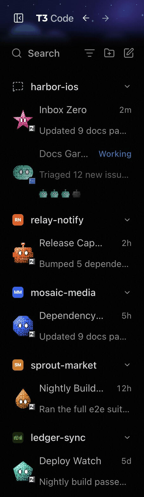
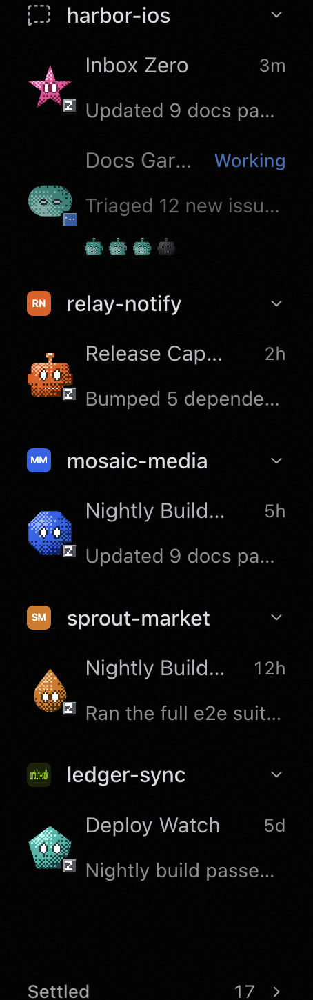
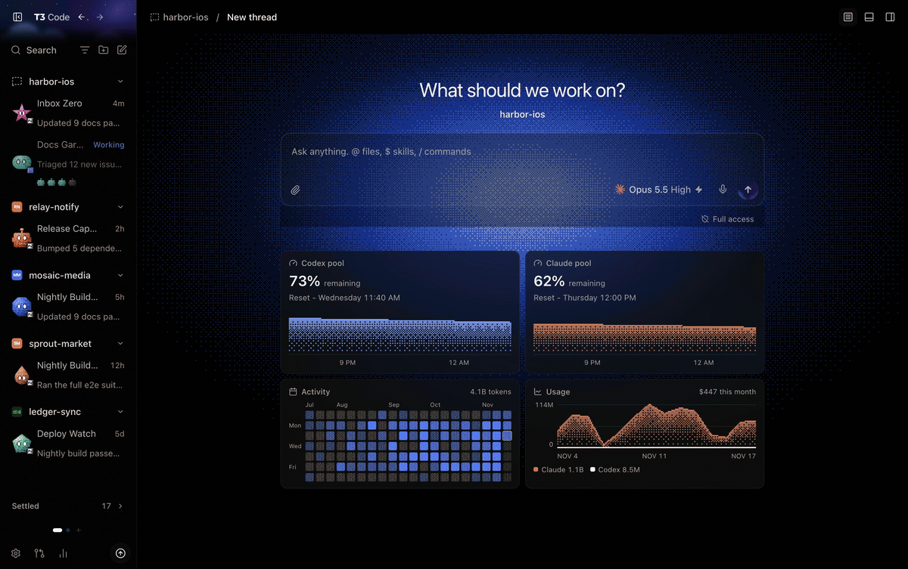
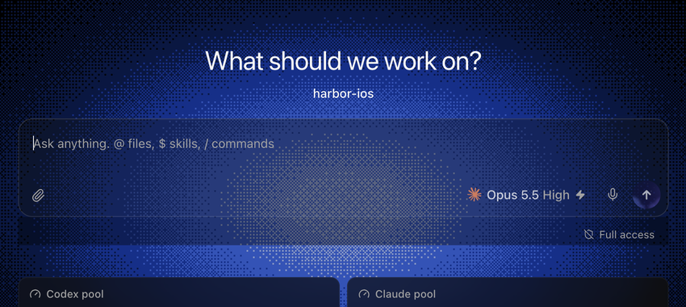
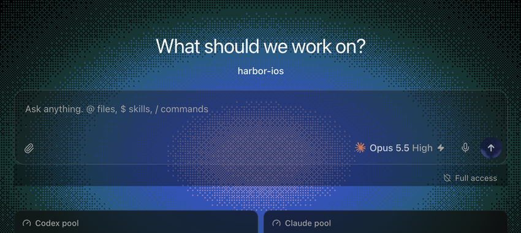
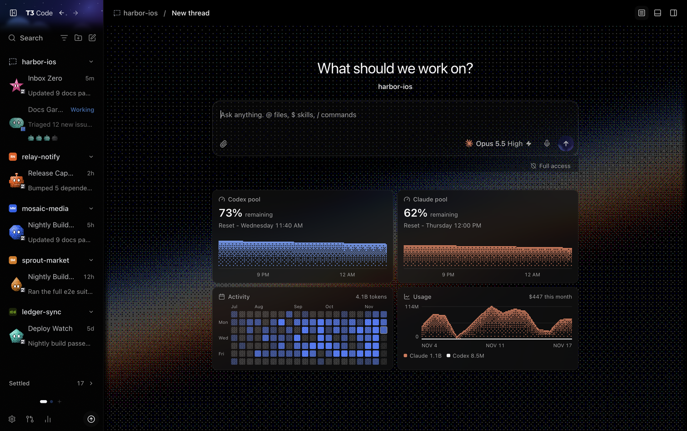

<div align="center">

# t3+ for T3 Code

**Pixel-art bots, a dithered glow, a glass composer and live usage widgets for the T3 Code desktop app.**


[Install](#install) · [Bots](#bots) · [Profiles](#profiles) · [Status view](#status-view) · [Glow](#glow-and-glass) · [Usage](#usage-at-a-glance) · [Settings](#settings) · [Walkthrough](#walkthrough)

</div>

## Install

Copy this to your coding agent (Claude Code, Codex, T3 Code itself):

```text
Install t3+ for T3 Code on this Mac:
1. git clone https://github.com/arjundgupta/t3plus ~/.t3plus
2. sh ~/.t3plus/build.sh   (needs Node 22.2 or newer)
3. With T3 Code open: node ~/.t3plus/t3plus.mjs on
4. Load it every time T3 Code starts:
   mkdir -p ~/Library/LaunchAgents && sed "s#__HOME__#$HOME#g" ~/.t3plus/launchd/com.t3plus.autostart.plist > ~/Library/LaunchAgents/com.t3plus.autostart.plist && (launchctl bootout gui/$(id -u)/com.t3plus.autostart 2>/dev/null; launchctl bootstrap gui/$(id -u) ~/Library/LaunchAgents/com.t3plus.autostart.plist)
```

That's it. Settings live in T3 Code under **Settings → t3+**.

- **Update:** `git -C ~/.t3plus pull && sh ~/.t3plus/build.sh && node ~/.t3plus/t3plus.mjs on`
- **Turn it off for now:** `node ~/.t3plus/t3plus.mjs off` (it loads again the next time T3 Code starts)
- **Uninstall:** `launchctl bootout gui/$(id -u)/com.t3plus.autostart; rm ~/Library/LaunchAgents/com.t3plus.autostart.plist; node ~/.t3plus/t3plus.mjs off; rm -rf ~/.t3plus`

You need macOS, the T3 Code desktop app and Node 22.2+.

## Bots

<table>
<tr>
<td width="260"></td>
<td>

Every thread becomes a little pixel-art bot with a face, its name and its latest message.

- **Moods**: eyes closed when idle, animated while the thread works.
- **Subagents**: small faces line up under a bot while it runs subagents, in the bot's own shape and color by default (pick others in Settings → t3+ → Subagents). Finished ones dim.
- **Status badges** (off to start): a small tile on each face that shows what the thread is doing.
- Pick a shape and color per bot in Settings, or let each one take its project's color.

</td>
</tr>
</table>

Five styles for bots you haven't customized (Settings → t3+ → Bot style):

| Classic | Sports | Space | Fruit |
|:---:|:---:|:---:|:---:|
|  |  |  |  |

And **Blobs**: soft blobs in the bot's color with two capsule eyes, always gently alive. They glance around, blink and breathe, and show the mood.

## Profiles

<table>
<tr>
<td width="260"></td>
<td>

Dots at the bottom of the sidebar, next to the profile's name. Each profile shows its own projects and keeps its own open thread.

- **Swipe** sideways with two fingers over the sidebar and the lists slide with your fingers. Or click a dot, or press **Ctrl+Shift+1–9**.
- Drag a project onto a dot, or right-click it → **Move to profile**, to move it.
- Right-click a dot to rename it, delete it, or give it an icon and its own colors (dot, sky, glow and chat bubbles).

</td>
</tr>
</table>

## Status view

<table>
<tr>
<td width="260"></td>
<td>

The button at the right of the profile dots turns the sidebar into a triage list: the profile's threads grouped into **Needs you**, **Working**, **Done** and **Idle**, newest first.

- It covers threads T3's own list hides, read from T3's database: approvals, questions, failed and rate-limited runs, goals and queued work.
- **Status colors** (Settings → t3+, off to start): in this view each bot wears its status's color. Orange needs you, red failed, yellow working, green done, blue idle. Back in the normal list, bots get their own colors again. Balls, planets and fruit always keep theirs.
- Swipe between profiles here too; the list slides just like the normal one.

</td>
</tr>
</table>

## Glow and glass

A dithered glow rises behind a see-through glass composer. It follows your T3 theme color, or any accent you pick.



Three pixel looks, plus a smooth gradient:

| Bayer | Grain | Spectrum |
|:---:|:---:|:---:|
|  |  |  |

You can also use your own image instead of the glow:



## Usage at a glance

Under the new-thread composer: your **Codex and Claude pools** with time to reset, a **tokens-per-day heatmap**, and **spend** this month. Hover anything for the details.


<table>
<tr>
<td width="260"></td>
<td>

Thread details show the current provider's pool, plus what that thread has cost so far.

Everything is read on your Mac: T3's own database, T3's local API and your Claude/Codex session logs. t3+ makes no network requests of its own.

</td>
</tr>
</table>

## Screenshot mode

Turn it on in Settings → t3+ to swap thread titles, projects, branches and messages for believable stand-ins, so you can share your screen without personal details. It's off by default. Every image on this page was taken with it on, and the usage numbers are sample data. Terminals, diffs and files stay real.

## Settings

Everything lives in T3 Code under **Settings → t3+**, with a live preview where it helps.


- **Per profile and per Mac**: the bar at the top ("Applying t3+ for All profiles on All devices") picks what you're changing. A setting that differs somewhere says so, with **Use for all** to make it the same again. Turning profiles on or off and screenshot mode are the same everywhere, as are each bot's own look and backups.
- **Changelog**: at the bottom, click it to see what's new in each version, right in Settings.


## Walkthrough

[](media/walkthrough.mp4)

## How it works

t3+ is injected into the running T3 Code app. `t3plus.mjs on` briefly opens Node's inspector on `127.0.0.1` in T3's main process, loads the mod and closes the inspector. Nothing in T3's install is modified, and `off` removes it cleanly. The optional launch agent runs the same step whenever T3 Code starts. Usage data is gathered in a background worker thread, so T3's main thread stays free.

## License

PolyForm Noncommercial 1.0.0, see [LICENSE](LICENSE).
