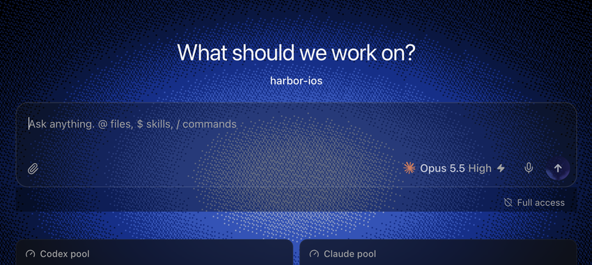
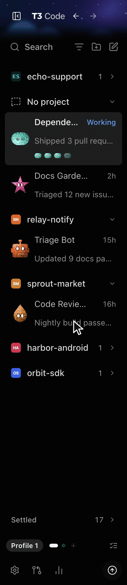
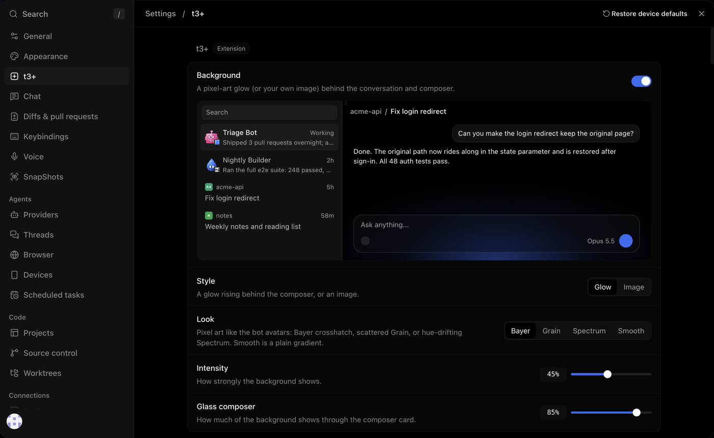

<div align="center">

# t3+ for T3 Code

**Pixel-art bots, a dithered glow, a glass composer and live usage widgets for the T3 Code desktop app.**


[Install](#install) · [Bots](#bots) · [Glow](#glow-and-glass) · [Usage](#usage-at-a-glance) · [Profiles](#profiles) · [Walkthrough](#walkthrough)

</div>

## Install

Copy this to your coding agent (Claude Code, Codex, T3 Code itself):

```text
Install t3+ for T3 Code on this Mac:
1. git clone https://github.com/arjundgupta/t3plus ~/.t3plus
2. sh ~/.t3plus/build.sh   (needs Node 22.2 or newer)
3. With T3 Code open: node ~/.t3plus/t3plus.mjs on
4. Load it every time T3 Code starts:
   mkdir -p ~/Library/LaunchAgents && sed "s#__HOME__#$HOME#g" ~/.t3plus/launchd/com.t3plus.autostart.plist > ~/Library/LaunchAgents/com.t3plus.autostart.plist && (launchctl bootout gui/$(id -u)/com.t3plus.autostart 2>/dev/null; launchctl bootstrap gui/$(id -u) ~/Library/LaunchAgents/com.t3plus.autostart.plist)
```

That's it. Settings live in T3 Code under **Settings → t3+**.

- **Update:** `git -C ~/.t3plus pull && sh ~/.t3plus/build.sh && node ~/.t3plus/t3plus.mjs on`
- **Turn it off for now:** `node ~/.t3plus/t3plus.mjs off` (it loads again the next time T3 Code starts)
- **Uninstall:** `launchctl bootout gui/$(id -u)/com.t3plus.autostart; rm ~/Library/LaunchAgents/com.t3plus.autostart.plist; node ~/.t3plus/t3plus.mjs off; rm -rf ~/.t3plus`

You need macOS, the T3 Code desktop app and Node 22.2+.

## Bots

<table>
<tr>
<td width="300"></td>
<td>

Every thread becomes a little pixel-art bot with a face, its name and its latest message.

- **Moods**: eyes closed when idle, animated while the thread works, with a status badge on the corner.
- **Subagents**: mini robots line up under a bot while it runs subagents, and finished ones go dark.
- Pick a shape and color per bot in Settings, or let each one take its project's color.

</td>
</tr>
</table>

Four styles for bots you haven't customized:

| Classic | Sports | Space | Fruit |
|:---:|:---:|:---:|:---:|
|  |  |  |  |

## Glow and glass

A dithered glow rises behind a see-through glass composer. It follows your T3 theme color, or any accent you pick.


Three pixel looks, plus a smooth gradient:

| Bayer | Grain | Spectrum |
|:---:|:---:|:---:|
|  |  |  |

You can also use your own image instead of the glow:


## Usage at a glance

Under the new-thread composer: your **Codex and Claude pools** with time to reset, a **tokens-per-day heatmap**, and **spend** this month. Hover anything for the details.


<table>
<tr>
<td width="260"></td>
<td>

Thread details show the current provider's pool, plus what that thread has cost so far.

Everything is read on your Mac: T3's own database, T3's local API and your Claude/Codex session logs. t3+ makes no network requests of its own.

</td>
</tr>
</table>

## Profiles

<table>
<tr>
<td width="260"></td>
<td>

Dots at the bottom of the sidebar, like Dia's profiles. Each profile shows its own projects.

- Click a dot, swipe sideways with two fingers, or press **Ctrl+Shift+1–9**.
- Drag a project onto a dot to move it.
- Right-click a dot to rename or delete it.

</td>
</tr>
</table>

## Screenshot mode

Turn it on in Settings → t3+ to swap thread titles, projects, branches and messages for believable stand-ins, so you can share your screen without personal details. It's off by default. Every image on this page was taken with it on, and the usage numbers are sample data.

## Settings



## Walkthrough

[](media/walkthrough.mp4)

## How it works

t3+ is injected into the running T3 Code app. `t3plus.mjs on` briefly opens Node's inspector on `127.0.0.1` in T3's main process, loads the mod and closes the inspector. Nothing in T3's install is modified, and `off` removes it cleanly. The optional launch agent runs the same step whenever T3 Code starts. Usage data is gathered in a background worker thread, so T3's main thread stays free.

## License

PolyForm Noncommercial 1.0.0, see [LICENSE](LICENSE).
