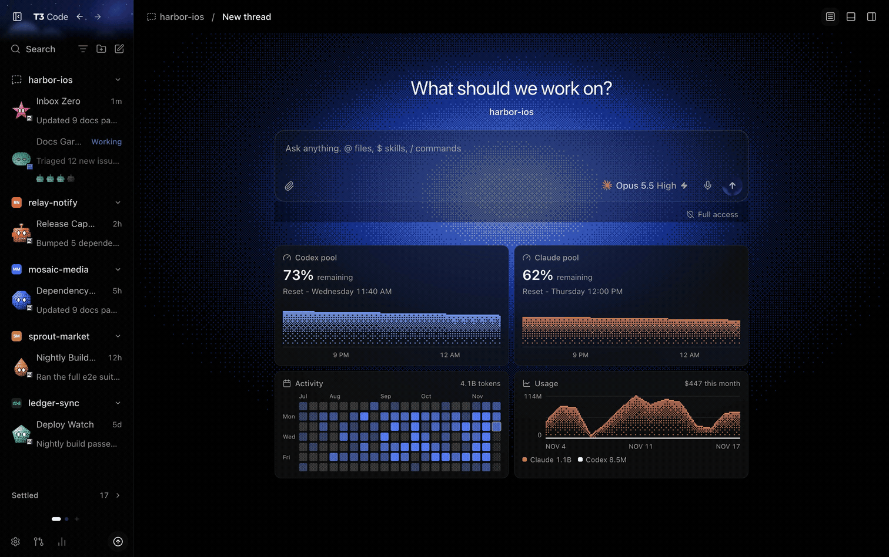
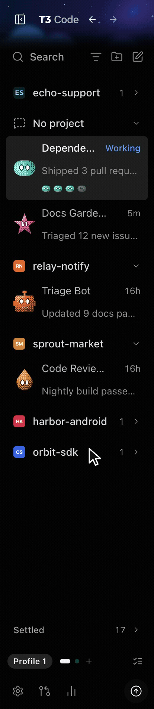
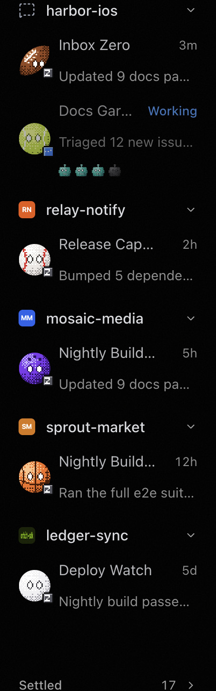
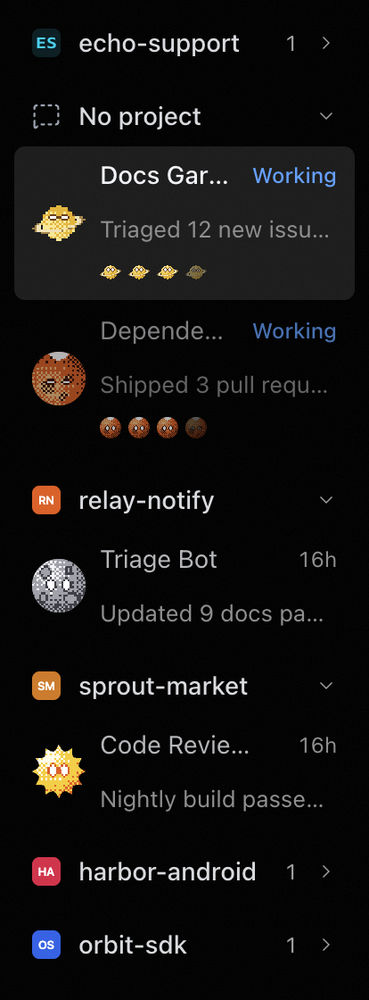
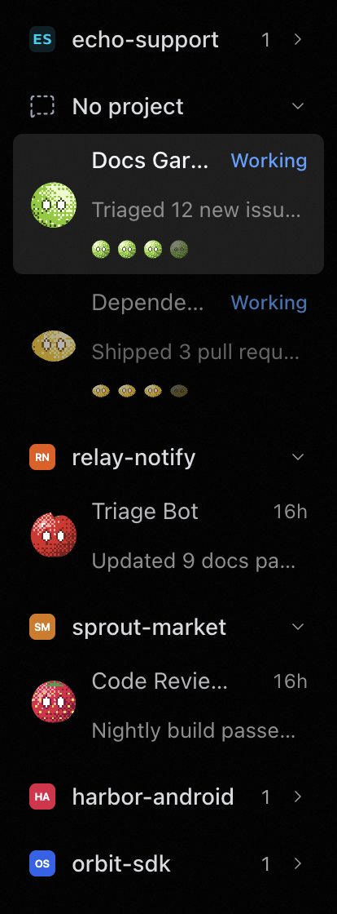
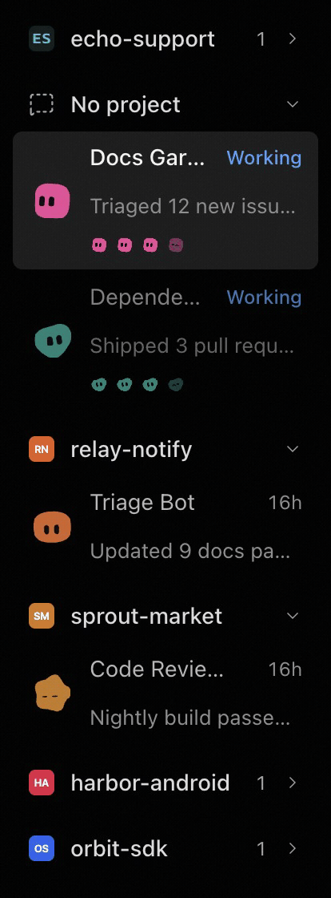
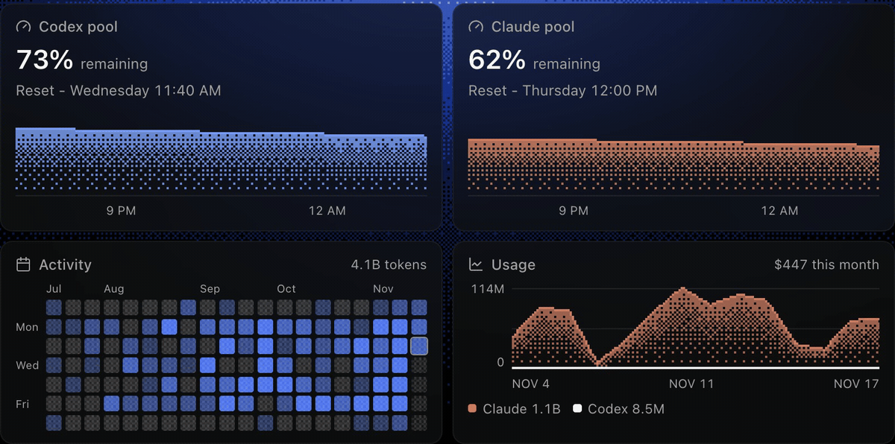
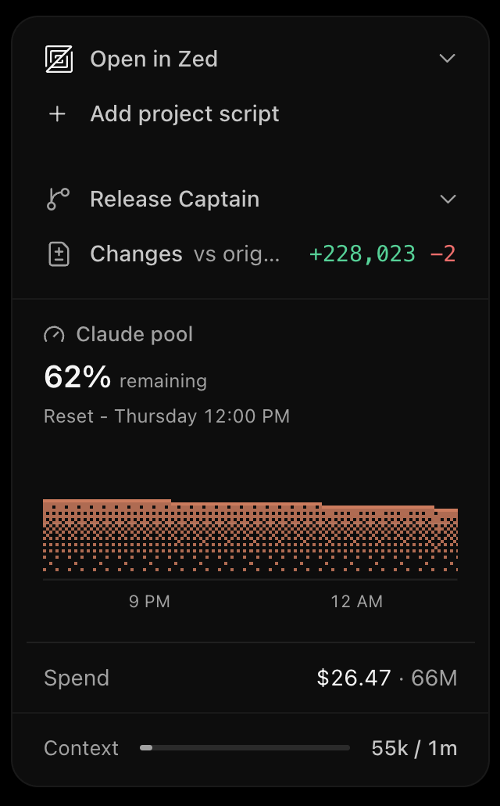
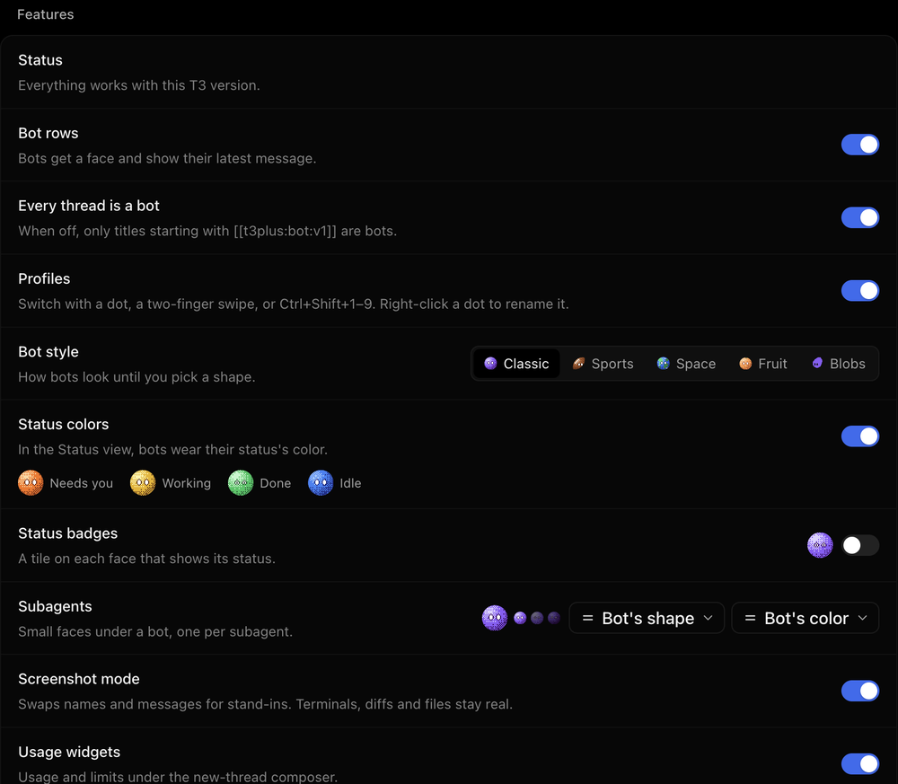

<div align="center">

# t3+ for T3 Code

Pixel-art bots, profiles, a dithered glow and usage widgets for the T3 Code desktop app.



[Install](#install) · [Glow](#glow-and-glass) · [Sidebar](#sidebar) · [Usage](#usage) · [Settings](#settings) · [Walkthrough](#walkthrough)

</div>

## Install

You need macOS, the T3 Code desktop app and Node 22.2+. Copy this to your coding agent (Claude Code, Codex or T3 Code itself):

```text
Install t3+ for T3 Code on this Mac:
1. git clone https://github.com/arjundgupta/t3plus ~/.t3plus
2. sh ~/.t3plus/build.sh   (needs Node 22.2 or newer)
3. With T3 Code open: node ~/.t3plus/t3plus.mjs on
4. Load it every time T3 Code starts:
   mkdir -p ~/Library/LaunchAgents && sed "s#__HOME__#$HOME#g" ~/.t3plus/launchd/com.t3plus.autostart.plist > ~/Library/LaunchAgents/com.t3plus.autostart.plist && (launchctl bootout gui/$(id -u)/com.t3plus.autostart 2>/dev/null; launchctl bootstrap gui/$(id -u) ~/Library/LaunchAgents/com.t3plus.autostart.plist)
```

Settings are in T3 Code under Settings → t3+.

- **Update:** `git -C ~/.t3plus pull && sh ~/.t3plus/build.sh && node ~/.t3plus/t3plus.mjs on`
- **Turn off:** `node ~/.t3plus/t3plus.mjs off` (it loads again when T3 Code restarts)
- **Uninstall:** `launchctl bootout gui/$(id -u)/com.t3plus.autostart; rm ~/Library/LaunchAgents/com.t3plus.autostart.plist; node ~/.t3plus/t3plus.mjs off; rm -rf ~/.t3plus`

## Glow and glass

A dithered glow sits behind a glass composer. It uses your T3 theme color, or any color you pick.


Three pixel looks, plus a smooth one:

| Bayer | Grain | Spectrum |
|:---:|:---:|:---:|
|  |  |  |

Or use your own image:


## Sidebar

<table>
<tr>
<th width="33%">Bots</th>
<th width="33%">Profiles</th>
<th width="33%">Status view</th>
</tr>
<tr valign="top">
<td></td>
<td></td>
<td></td>
</tr>
<tr valign="top">
<td>

Every thread is a pixel-art bot with a face, a name and its latest message.

- **Moods:** eyes closed when idle, animated while working.
- **Subagents:** small faces under the bot. Finished ones dim.
- **Status badges:** a tile on each face. Off by default.
- **Looks:** pick a shape and color per bot.

</td>
<td>

Dots at the bottom of the sidebar. Each profile has its own projects and open thread.

- **Switch:** swipe with two fingers, click a dot, or press Ctrl+Shift+1–9.
- **Move a project:** drag it onto a dot, or right-click it.
- **Edit:** right-click a dot to rename it or set its icon and colors.

</td>
<td>

The button next to the dots groups threads into Needs you, Working, Done and Idle.

- **Complete:** shows threads T3's list hides, like approvals and failed runs.
- **Status colors:** orange needs you, red failed, yellow working, green done, blue idle. Off by default.
- **Swipe:** switches profiles here too.

</td>
</tr>
</table>

Five styles for bots you haven't customized:

| Classic | Sports | Space | Fruit | Blobs |
|:---:|:---:|:---:|:---:|:---:|
|  |  |  |  |  |

Blobs are always moving. They look around, blink and breathe.

## Usage

Under the new-thread composer: your Codex and Claude pools, a tokens-per-day heatmap and this month's spend. Hover for details.



<table>
<tr>
<td width="260"></td>
<td>

Thread details show the provider's pool and what the thread has cost.

All data is read on your Mac, from T3's database, T3's local API and your Claude and Codex logs. t3+ makes no network requests.

</td>
</tr>
</table>

## Settings

Everything is in Settings → t3+, with previews.


- **Per profile and device:** the bar at the top picks what you're changing. Use for all makes a setting the same everywhere again.
- **Changelog:** at the bottom. Click it to see what changed.



## Walkthrough

[](media/walkthrough.mp4)

## License

PolyForm Noncommercial 1.0.0. See [LICENSE](LICENSE).
